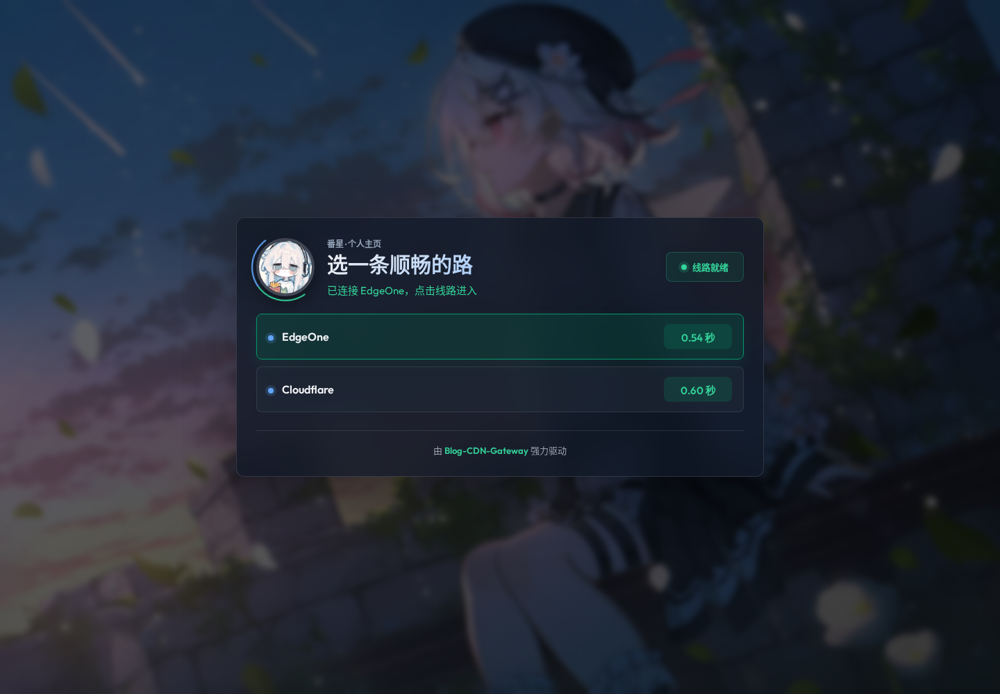
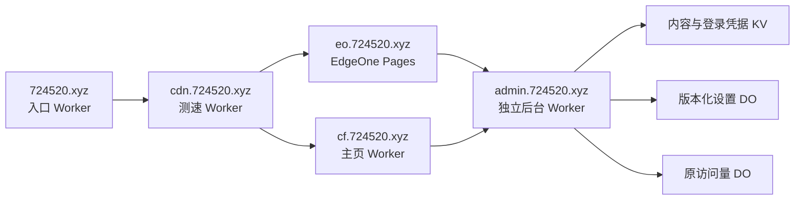

<!-- fanxing-style:start -->
<picture>
  <source media="(prefers-color-scheme: light)" srcset="https://fanxing724.github.io/new-make/fanxing724/projects/me/cover.light.svg">
  
</picture>

**一个入口，收好我的网站、音乐和日常折腾。**

番星 / 星轨手记 · [项目名片](https://fanxing724.github.io/new-make/fanxing724/projects/me/intro.md)
<!-- fanxing-style:end -->

# 番星 · 个人主页与自定义后台

原生 HTML/CSS/JavaScript 个人主页，配套独立管理后台、Cloudflare / EdgeOne 双线路和浏览器测速入口。没有常驻服务器，也不需要前端框架。

[访问主页](https://724520.xyz/) · [手动选择线路](https://cdn.724520.xyz/?manual=1) · [完整设计](docs/architecture.md) · [部署指南](DEPLOYMENT.md)



## 当前结构



Cloudflare 上有四个 Worker，分别负责主页、后台、测速和主域名跳转；“Workers 和 Pages”是控制台的统一栏目名称，不代表创建了四个 Pages 项目。EO 是另一平台的独立 Pages 项目。主域名入口可用 [重定向规则](docs/redirect-rules.md)替代，减少一个 Worker；当前线上仍保留独立 Worker 方案。

## 能自定义什么

- 个人资料、GitHub 用户名、位置、状态、标签、头像、背景、网站和社区入口。
- 音乐来源、网易云 / QQ 歌单、自定义曲目、排序、封面、歌词、默认音量和播放模式；草稿歌单可测试、试听。
- 强调色、圆角、字号、页面宽度、背景遮罩、模糊、卡片列数与装饰动画。
- 模块显隐和顺序、公告、头衔、小票文案与随机内容、电脑档案和维修记录、页脚。
- 测速页标题、状态文案、线路名称、启停、超时和自动跳转。
- 完整 JSON 备份、旧版备份导入、最近 12 版设置、草稿恢复和保存冲突提示。

修改先进入草稿，保存才发布。CF 与新版 EO 主页在下次刷新时读取同一份后台设置；访客自己的音量和播放模式优先。未登录和跨站请求不能修改后台内容。音乐不会强制自动播放。

[后台预览](docs/images/backend.png) · [功能与同步设计](docs/customization.md) · [播放器说明](docs/music-player.md)

## 目录

| 路径 | 用途 |
|---|---|
| `worker.mjs`、`public/` | CF 公开主页、公开接口转发、原计数 DO |
| `backend/`、`admin/` | 登录、管理页、设置服务与版本历史 |
| `edge-functions/` | EO 公开数据、设置、音乐、计数和探测函数 |
| `gateway/` | 原版 Blog-CDN-Gateway 页面、头像与背景资源、接入适配 |
| `entry/` | 主域名临时跳转，后台导航转向独立后台 |
| `tools/` | 后台构建、公开快照刷新、EO 构建与 ZIP 打包 |
| `tests/` | 无第三方依赖的核心行为测试 |
| `wrangler*.jsonc` | 不含实际账号绑定的配置模板 |

根目录旧 `index.html`、`static/`、`worker.js` 是保留的上游历史文件；当前发布入口以上表和 Wrangler 模板为准。

## 本地检查与构建

需要 Node.js 24+、Python 3，以及刷新线上快照时使用的 curl；部署时使用 Wrangler。

```sh
npm test
python3 tools/build-backend.py
node gateway/build.mjs
python3 tools/package-edgeone.py
```

EO ZIP 的第一层就是 `index.html` 和 `edge-functions/`，可直接上传。构建只读取仓库内公开资源，不需要本机私有文件；刷新快照为可选的只读网络操作。

实际部署配置使用被 Git 忽略的 `*.deploy.jsonc`，密码、会话签名密钥、Cookie、KV 私有数据和本机部署记录均不提交。新部署须自行初始化管理员，没有可用的默认账号密码。

**保留访问量存储：**原 `PageViewCounter` 仍托管于 `fanxing-homepage`。不要直接删除它的类导出、绑定、迁移历史或整个 Worker；如要移除 CF 主页，先单独迁移历史计数器。

## 验证与边界

核心测试覆盖设置版本比较、历史上限、鉴权、跨站拒绝、公开转发不携带 Cookie、测速无计数副作用、入口边界以及原版 CDN 样式保留。浏览器验证覆盖手机布局、表单保存、保存中继续编辑、备份/恢复、手动进入、故障回退和完整跳转。

仓库包含新版 EO 可部署代码；EO 线上是否已经更新，应以实际部署的 `/cdn-check` 版本和接口为准。测速是首个健康响应选线，不是吞吐测试，也不保证按地域固定选平台。

## 来源与许可

- 个人主页基于 [IonRh/HomePage](https://github.com/IonRh/HomePage)，保留根目录 [MIT 许可](LICENSE)。
- CDN 页面直接使用 [cmliu/Blog-CDN-Gateway](https://github.com/cmliu/Blog-CDN-Gateway)，原始源码与 [MIT 许可](gateway/vendor/LICENSE)保存在 `gateway/vendor/`；页面样式未重新设计。
- Font Awesome 字体许可保存在 `public/webfonts/LICENSE.txt`。
- Ubuntu 壁纸说明保存在 `public/assets/ubuntu-wallpaper-copyright.txt`；备用试听录音来源与 CC BY 2.5 说明在 `public/assets/music/credits.html`。
- 用户提供的头像、插画与其他媒体不因代码许可而自动转为 MIT，继续保留各自权利。
